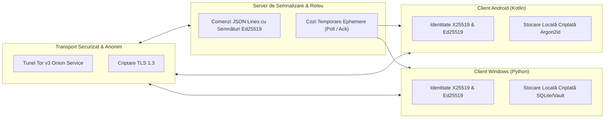
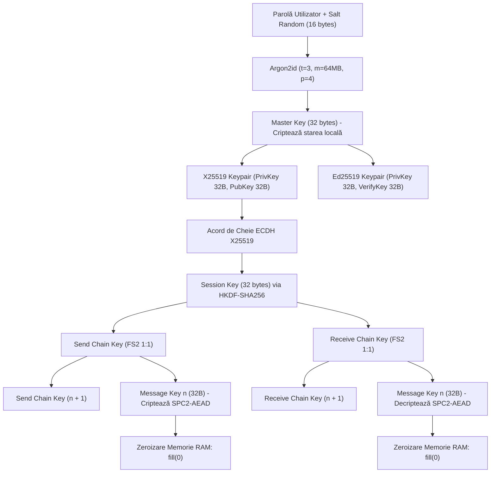
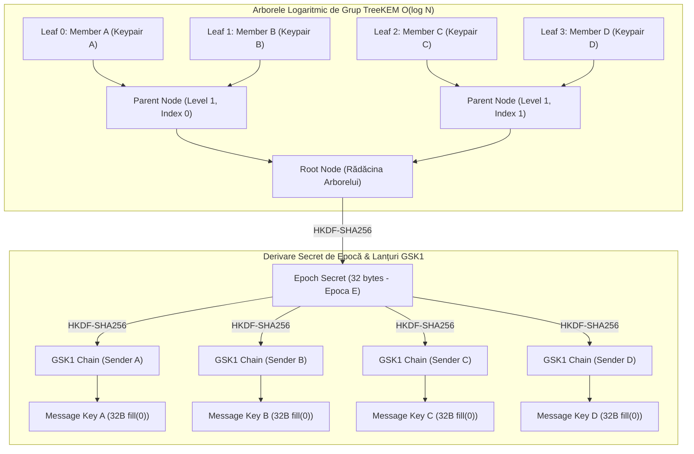
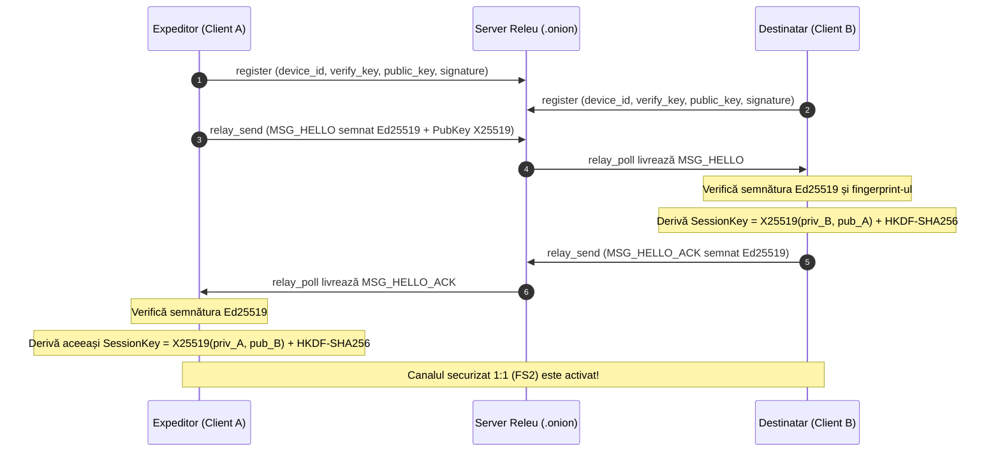
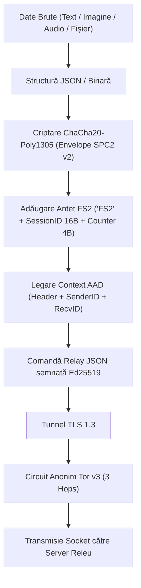
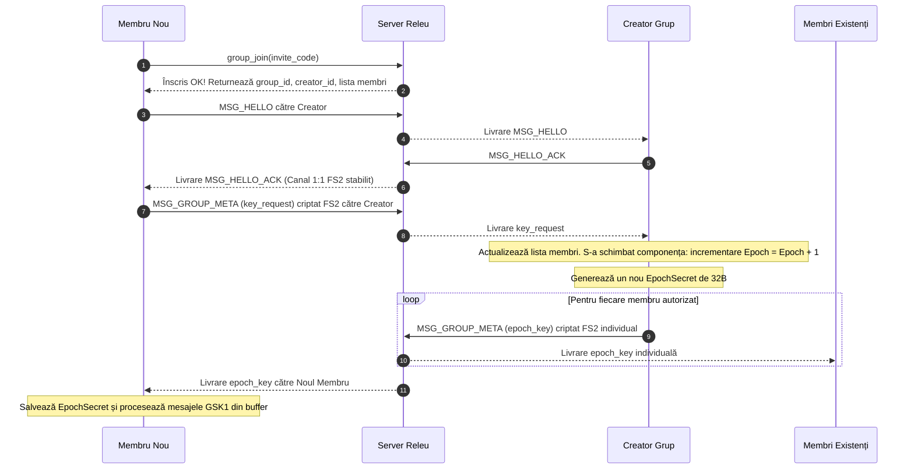
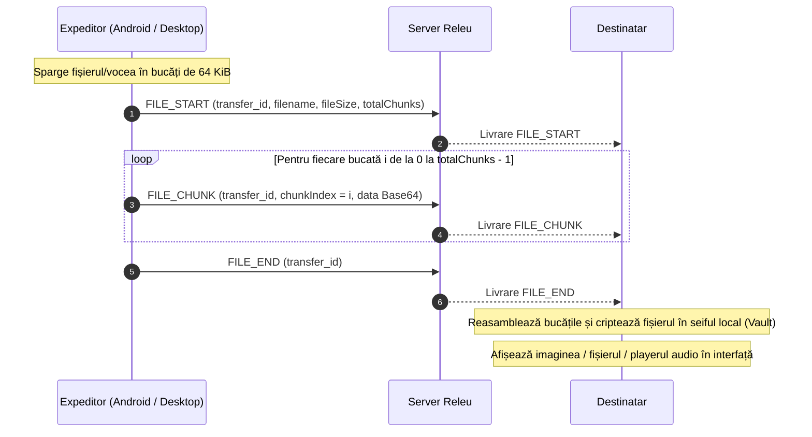

# Arhitectura Criptografică și Diagramarea Sistemului SecureP2PChat

Acest document conține specificația tehnică completă a sistemului **SecureP2PChat** (interoperabilitate Android Kotlin și Windows Python), documentată exclusiv prin **diagrame Mermaid** și explicații criptografice precise.

---

## 1. Arhitectura Rețelei și Relația Client - Server Releu

 Această diagramă descrie arhitectura de rețea, filtrarea prin Tor v3 / TLS 1.3 și comunicarea asincronă cu serverul de semnalizare.

---

## 2. Arborele Criptografic de Derivare a Cheilor 1:1 (Key Generation Tree)

 Diagrama de derivare ierarhică a cheilor de la parola utilizatorului până la cheile unice de mesaj 1:1 per sesiune.

---

## 3. Arborele Criptografic al Cheilor de Grup (TreeKEM / MLS & GSK1 Tree)

 Această diagramă arată structura arborelui de chei de grup (Logarithmic TreeKEM / RFC 9420) și derivarea lanțurilor de mesaje per expeditor (GSK1):

---

## 4. Stabilirea Identității și a Cheilor 1:1 (Handshake HELLO)

 Secvența de conectare, autentificare prin semnătură digitală Ed25519 și derivare a cheii de sesiune 1:1.

---

## 5. Criptarea și Încapsularea Datelor (Transport & E2EE)

 Diagrama etapelor prin care trece un mesaj înainte de a fi transmis prin rețea.

---

## 6. Fluxul de Alăturare a unui Membru Nou și Rotația Epocii de Grup

 Diagrama de secvență pentru cererea și distribuirea cheii de grup la alăturarea unui membru nou.

---

## 7. Transferul de Fișiere, Poze și Înregistrări Audio (Voice) în 1:1 și Grup

 Transferul fișierelor și al înregistrărilor audio prin fragmentare în bucăți de 64 KiB.

---

## 8. Specificația Algoritmilor Criptografici Utilizați

| Componentă | Algoritm / Standard | Parametri / Detalii Tehnice |
| :--- | :--- | :--- |
| **Protecție Locală** | Argon2id | $t=3$ iterații, $m=65536 \text{ KB}$ ($64 \text{ MB}$), $p=4$ paralelism |
| **Schimb Chei 1:1** | X25519 (Curve25519) | ECDH de 256 biți |
| **Semnătură Digitală** | Ed25519 | Autentificarea comenzilor și pachetelor HELLO |
| **Ratchet 1:1 (FS2)** | Symmetric Chain Ratchet | HKDF-SHA256, fereastră de skip $\le 1024$ mesaje |
| **Arbore Grup** | TreeKEM (RFC 9420 / MLS) | Arbore logaritmic $O(\log N)$, direct path updates |
| **Ratchet Mesaje Grup**| Group Sender Key Chain | HKDF-SHA256 derivat per expeditor și epocă |
| **Criptare Simetrică** | XChaCha20-Poly1305 (SPC2) | Nonce 24B, Tag 128-bit, AAD context binding |
| **Zeroizare Memorie** | Memory Wipe (`fill(0)`) | Ștergere directă a cheilor unice din RAM |
